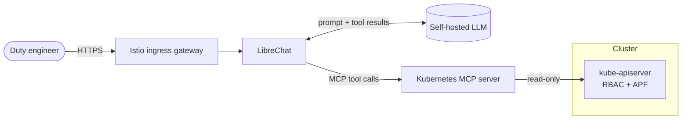

# LibreChat + Kubernetes MCP Server Service Design

| **Metadata**      | **Value**                                  |
|--------------------|--------------------------------------------|
| **Status**         | Current                                    |
| **Owners**         | @wenbierrr                                 |
| **Created**        | 2026-11-17                                 |
| **Last Reviewed**  | 2026-11-17                                 |

## Change log

| Version | Date       | Description                | Author |
|---------|------------|-----------------------------|--------|
| 1.0.0   | 2026-11-17 | Initial release    | @wenbierrr |

---

## 1. What this is, and why we run it

This is an AI troubleshooting assistant for duty engineers (DEs). A DE asks a question in LibreChat, a chat UI (SAIP product). The LLM behind LibreChat calls tools on the Kubernetes MCP server to read pods, events, logs, and Istio and Argo objects, then works back to a root cause and a fix. The DE applies the fix. The tool never writes.

It gives every DE the context they would otherwise lack, so fewer issues are escalated and incidents are resolved sooner. It is built so that it **cannot be misused** (read-only, Secrets excluded, §9) and **cannot disrupt cluster operations** (its load on the API server is capped, §9).

Why LibreChat with this MCP server over the alternatives: see [ADR-01](../adr/adr-1-adopt-librechat-kubernetes-mcp.md).

## 2. Key concepts

**MCP (Model Context Protocol):** an open protocol that lets an LLM client discover and call tools on a server. Here LibreChat is the client, the Kubernetes MCP server is the server, and they talk over streamable HTTP.

**Tool call:** one action the LLM asks for, such as `pods_list_in_namespace`. Each tool call becomes one or more kube-apiserver requests.

**System prompt (`serverInstructions`):** the instructions LibreChat sends to the LLM along with the MCP server's tools. They set how the LLM investigates and how it answers (§5).

**API Priority and Fairness (APF):** the kube-apiserver's built-in traffic control. A `FlowSchema` sorts each request into a priority level. Each `PriorityLevelConfiguration` has a fixed number of requests it can run at once.

## 3. Architecture at a glance

Each cluster runs its own copy of everything above.

What to notice:

- **One path into the cluster.** LibreChat has no cluster access of its own. Every read goes through the MCP server's ServiceAccount.
- **Two guardrails at the kube-apiserver.** RBAC keeps that ServiceAccount read-only, with Secrets excluded. APF stops it from DDoSing cluster operations.

## 4. Components

**LibreChat** (namespace `librechat`)

| Component | Kind | What it does | Source |
|---|---|---|---| 
| `librechat-librechat` | Deployment, 1 replica | Chat UI and API. The MCP client, and the only component that calls the LLM | Upstream image `registry.librechat.ai/librechat-ai/librechat:v0.8.7` |
| MongoDB | Deployment, 1 replica | Accounts and conversation history, including every tool call | Upstream Bitnami subchart |
| Meilisearch | StatefulSet, 1 replica | Search index over conversations | Upstream subchart |

**Kubernetes MCP server** (namespace `k8-mcp-server`)

| Component | Kind | What it does | Source |
|---|---|---|---|
| `kubernetes-mcp-server` | Deployment, 1 replica | Serves the MCP tools on `:8080` and turns tool calls into API reads | Upstream image `quay.io/containers/kubernetes_mcp_server:latest` |

## 5. How it works

1. A DE signs in to LibreChat and asks a question.
2. LibreChat sends the conversation to the LLM, along with the MCP server's tool list and the system prompt.
3. The LLM decides what to do next:
   - **Needs more context** (e.g. which namespace) → it asks the DE. When the DE replies, the flow returns to step 2.
   - **Needs cluster data** → it replies with a tool call, and the flow continues at step 4.
   - **Can name the cause** → the flow skips to step 7.
4. LibreChat forwards the tool call to `http://kubernetes-mcp-server.k8-mcp-server.svc.cluster.local:8080/mcp`. The MCP server turns it into kube-apiserver reads, authenticated with its read-only ServiceAccount token.
5. The kube-apiserver applies the rate limit (§9), then RBAC. Anything the ClusterRole doesn't grant, such as a Secret, `nodes/proxy` or any write, gets a 403, which goes back to the LLM as a tool error.
6. The result goes back to the LLM through LibreChat, and the flow returns to step 3.
7. The LLM answers in a fixed format. The DE decides whether to apply the fix.

### The system prompt

The system prompt lives in LibreChat's `values.yaml` under `librechat.configYamlContent`. LibreChat restarts automatically when it changes.

| It tells the LLM to | Why |
|---|---|
| Work in one namespace. Ask for it if the DE hasn't named one, and never scan the cluster to find it | Cluster-wide lists are the slowest and most expensive calls |
| Follow a fixed order: pods → Warning events → the failing pod and its logs → the request path (Service, NetworkPolicy, Istio). Go to another namespace only when evidence points there | Mirrors how a DE troubleshoots, and keeps the number of calls low |
| Stop as soon as it can name the cause | Fewer API calls, faster answers |
| State only what a tool returned, and ask when the DE's intent is unclear | Reduces the risk of invented causes (hallucination) |
| Answer as **Root cause / Evidence / Fix / Confidence** | The same shape every time. The user guide explains how to read it |
| Never write or apply a fix | Only the DE applies changes |

The prompt is guidance, not a control. What actually enforces the limits are the MCP server's read-only mode, RBAC (read-only ClusterRole) and APF (§9).

## 6. Supported use cases and patterns

**Supported:**

- **Workload troubleshooting.** Pods that won't start, crashloop or can't be reached: reads pods, events, logs, Services, NetworkPolicies and storage.
- **Cross-namespace troubleshooting.** Follows the evidence from one namespace into another, such as a caller in one namespace failing to reach a service in another.
- **Istio troubleshooting.** Sidecars, routing (VirtualService, DestinationRule), mTLS (PeerAuthentication) and access policies (AuthorizationPolicy).
- **Argo CD app troubleshooting.** Applications that won't sync or show OutOfSync, and failed sync hooks.

**Not supported:**

- **Any write.** The DE applies every fix.
- **Secrets.** This also rules out Helm release history (stored in Secrets) and Argo cluster credentials.
- **`exec`, `attach`, `port-forward`, `nodes/proxy`.** No live Envoy inspection, so nothing like `istioctl proxy-config`.
- **Git.** The tool sees live objects, not the repository that produced them. GitLab MCP is out of scope and will be revisited if git access is needed.
- **Per-user access.** Every LibreChat user reads as the same ServiceAccount.
- **Cross-cluster queries.** Each cluster has its own LibreChat and MCP server, and a DE uses the one in the affected cluster. A single central LibreChat for all clusters is out of scope.

## 7. Interfaces & Dependencies

### Interfaces

| Interface | Used by | For |
|---|---|---|
| LibreChat web UI (HTTPS, via the Istio ingress gateway) | DEs | Asking questions |
| `/mcp` (MCP over streamable HTTP, in-cluster only) | LibreChat | Tool calls. The MCP server isn't exposed outside the cluster |
| Both `values.yaml` files | Platform engineer | Configuration, RBAC, system prompt |

### Dependencies and connectivity

| Dependency | If unavailable |
|---|---|
| kube-apiserver | Every tool call fails. The LLM reports that it cannot read the cluster |
| Self-hosted LLM | LLM will not return any responses |

## 8. Capacity & Availability

### Resources and scale

| Component | CPU / memory Request |
|---|---|
| MCP server | 100m / 128Mi |
| LibreChat | 100m / 128Mi |
| MongoDB, Meilisearch | 100m / 128Mi |

### Availability and data protection

- No HA: every component runs a single replica.
- If the MCP server is down, chats still work but every Kubernetes tool call fails. If LibreChat is down, DEs can't use the tool, but the cluster is unaffected.
- The MCP server is stateless, so a redeploy restores it.
- MongoDB holds accounts and conversation history. It is stored on a persistent volume. Meilisearch can be rebuilt from MongoDB which means Meilisearch does not need its own backup.
- `librechat-credentials-env` must never be regenerated for an existing deployment. Doing so breaks encrypted data and existing logins.

## 9. Security Posture

### 1 - Read-only access

Two independent guardrails, enforced in different places:

| Guardrail | Enforced by | Effect |
|---|---|---|
| **Read-only mode** (`config.read_only: true`, off by default) | The MCP server | Hides every write tool (create, update, delete, scale, exec, run), so the LLM never sees them |
| **ClusterRole `kubernetes-mcp-server-read-no-secrets`** | The kube-apiserver | Grants only `get`, `list` and `watch`. Every other request gets a 403 |

Writes are blocked twice: if a write tool were ever exposed, RBAC would still refuse it. What can be read is decided by the ClusterRole alone:

| Can read | Cannot read or do |
|---|---|
| Core objects (pods, pod logs, Services, endpoints, ConfigMaps, events, nodes, PVCs, …) | Secrets |
| Workloads, networking, storage, RBAC objects, CRDs, admission webhooks | `pods/exec`, `pods/attach`, `pods/portforward`, `nodes/proxy` |
| Istio, Argo CD, Gateway API, OpenShift (Routes, SCCs, OLM, cluster config) | Any write |

### 2 - Kube API rate limit

**APF (API Priority and Fairness)** stops the tool from DDoSing the kube-apiserver. The MCP server's requests get their own small, capped slice of API server capacity. If the LLM loops, or a prompt injection makes it flood the API, only that slice fills up: the excess is queued, then rejected with HTTP 429, and the rest of the cluster's API traffic is unaffected. Setup and limits: [installation §3](../deployment/installation.md#3-add-the-api-rate-limit-apf).

### 3 - Container CVE scan
- **CVE scan:** no report yet. TODO: `report/` entry to be linked.

## 10. Deployment shape

- **Per cluster:** one LibreChat release (`librechat`), one Kubernetes MCP server release (`k8-mcp-server`) and the APF manifest. All are deployed through GitOps.
- **Rollout order:** stg first, for a soak period of 2 weeks, then each remaining cluster in turn.
- **How to install:** the MCP server, its RBAC and rate limit: [installation.md](../deployment/installation.md). LibreChat: [here]().

## 11. History, Limitations & Roadmap

### Decisions that shaped this

| ADR | What it settled |
|---|---|
| [ADR-01](../adr/adr-1-adopt-librechat-kubernetes-mcp.md) | LibreChat with the Kubernetes MCP server, chosen over k8sgpt. Read-only, Secrets excluded |

### Limitations and known gaps

- **Access to the tool = access to the whole cluster.** The MCP server reads as its own ServiceAccount, not as the user, so access can't be narrowed per team. The tool can therefore be released only to DEs, not to app teams for self-service.
- **The API audit log can't name the DE.** For the same reason, every request is logged as the MCP server's ServiceAccount.
- **Blind to git, and a deskilling risk.** Both are accepted in ADR-01.

### Future considerations

- **More MCP servers to reduce blind spots.** The tool sees only live Kubernetes objects. If DEs often hit problems it can't see, another MCP server can be added, such as GitLab MCP for what is in git.
- **A single central LibreChat** for all clusters, instead of one per cluster.

